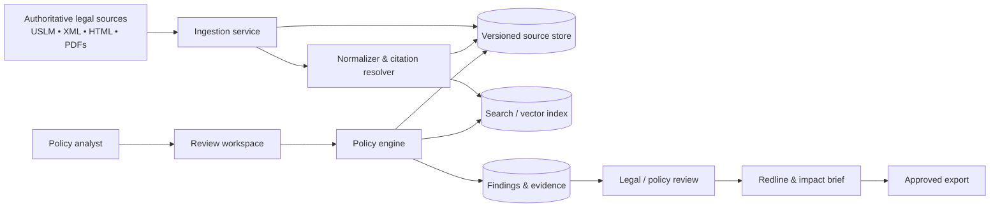
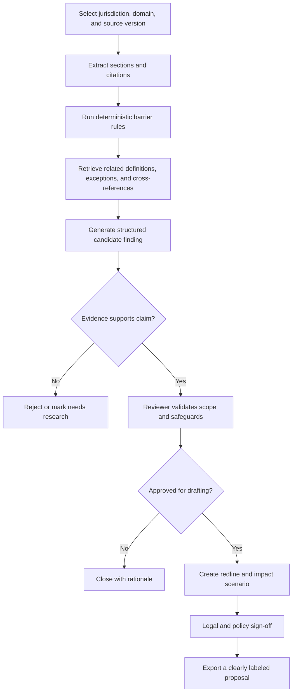
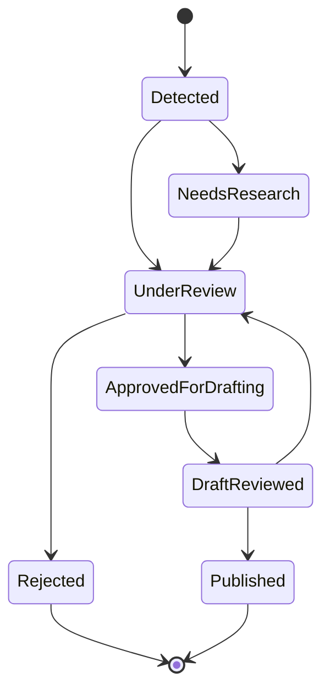

# DOGE Factory architecture

## Design goal

Produce a **citation-backed policy modernization case**: a reviewer can trace every finding and proposed change to a versioned source provision, a stated detection rule, and documented assumptions. The system must not present a draft as enacted law or execute legislative outreach without approval.

## System context

## Policy-engine pipeline

## Deployment boundaries

| Boundary | Responsibility | Requirement |
| --- | --- | --- |
| Source acquisition | Fetch and retain original legal material | Record URL, publisher, retrieval time, checksum, and license/terms. |
| Source store | Immutable source snapshots | Never overwrite an analyzed version. |
| Analysis service | Rules, retrieval, and structured generation | Every claim links to a source span and confidence is not treated as proof. |
| Review workspace | Triage, annotations, approvals | Role-based access and a complete decision audit trail. |
| Export service | Memo and redline generation | Watermark drafts as proposed and include version/citation data. |

## Human-review states

Only a reviewer can transition a finding to `ApprovedForDrafting`; only an authorized publisher can transition a draft to `Published`.
