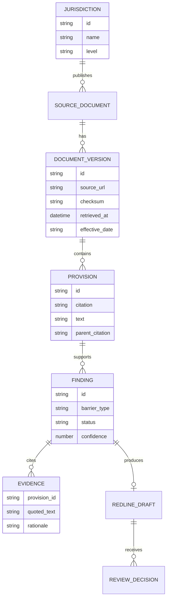

# Policy-engine MVP

## First vertical

Start with **one municipality + housing permits**. It is narrow enough to establish source-quality, citation, detection, and review practices before addressing the variation across jurisdictions and policy areas.

## Core records

## Detection taxonomy

Candidate findings should be assigned one or more explicit categories. A category is a triage signal, not a legal conclusion.

| Category | Example lexical signals | Required reviewer check |
| --- | --- | --- |
| Paper-only artifact | “paper form”, “written in ink”, “duplicate copy” | Is electronic equivalence already allowed elsewhere? |
| Physical-presence requirement | “in person”, “personally appear” | Does identity, accessibility, or due process require it? |
| Wet-signature requirement | “signed under oath”, “original signature” | Are digital-signature alternatives legally sufficient? |
| Manual processing mandate | “clerk shall manually”, “hand-deliver” | Is a human decision legally required or merely historically assumed? |
| Fixed timing/queue rule | “within X days after receipt” | Would automation change statutory service or appeal rights? |
| Record-access constraint | “public inspection”, “confidential” | What privacy, retention, and public-record obligations apply? |

## Finding contract

The analysis service must emit records conforming to [`schemas/finding.schema.json`](../schemas/finding.schema.json). In particular:

- Evidence is a verbatim source quotation plus a stable citation.
- The model may propose an interpretation, but cannot invent a citation.
- Cross-references, exceptions, definitions, and effective dates must be resolved before drafting.
- Cost estimates are scenarios with disclosed inputs, ranges, and provenance—not “exact savings.”

## Review checklist

Before a redline can be exported, a reviewer confirms:

- [ ] Source document and version are authoritative for the selected jurisdiction.
- [ ] Quoted text supports the asserted requirement.
- [ ] Definitions, exceptions, and cross-references were examined.
- [ ] The proposed change preserves required notice, appeal, privacy, accessibility, and retention safeguards.
- [ ] A qualified legal reviewer has approved the drafting instruction.
- [ ] Fiscal inputs, uncertainty, and exclusions are visible in the brief.
- [ ] The result is labeled as a proposal, not legal advice or enacted law.

## MVP backlog

### Milestone 1 — trustworthy corpus

- [ ] Jurisdiction registry and source connector
- [ ] Immutable source snapshot + checksum
- [ ] Section/citation parser and search
- [ ] Provenance display in the review workspace

### Milestone 2 — auditable audit

- [ ] Configurable lexical and structural barrier rules
- [ ] Hybrid retrieval over provisions and cross-references
- [ ] Structured finding generation against the JSON schema
- [ ] Reviewer queue, annotations, and disposition history

### Milestone 3 — controlled redline

- [ ] Side-by-side source / proposed text editor
- [ ] Amendment rationale and safeguard checklist
- [ ] Assumption-driven fiscal scenario template
- [ ] PDF/Markdown export with citations and draft watermark

## Non-goals for the MVP

- Fully autonomous legal interpretation or amendment publication
- Scraping sources that prohibit automated access
- Claiming realized savings without validated implementation data
- Automated constituent contact or lobbying workflows
